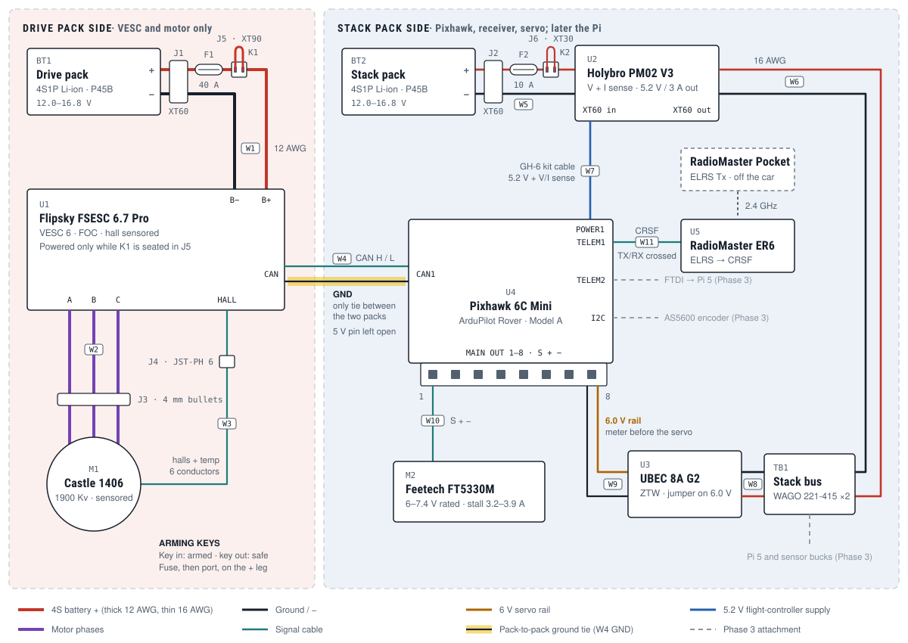

# Robocar v2 Harness

_How v2 is wired, phase by phase. Each phase's parts come from the Robocar v2 BOM
(a Claude Docs page outside the repo); this file is the record of how they connect.
Update the wire list as the harness is built, and log every measured value below._

**Status:** Phase 2 drawn 2026-10-07; arming keys added 2026-10-15. Not yet built.

## Phase 2: radio-controlled car

Phase 2 is everything needed to drive under the transmitter, before the Pi or any
autonomy code. Steering and throttle go through the Pixhawk: the ER6 feeds it CRSF,
it drives the servo from MAIN OUT 1 and the VESC over DroneCAN.



Two packs and one ground tie. The drive pack feeds only the VESC and motor. The stack
pack feeds the Pixhawk (through the PM02), the ER6 (from TELEM1) and the 6 V servo
rail (through the UBEC). The ground in the CAN cable (W4) is the single conductor
joining the two sides. Each pack's + leg runs through its fuse and then an arming
port; seating that side's key closes the port and powers the side.

### Rules the harness depends on

- **One ground tie.** Servo, ER6 and Pixhawk all return to the stack pack. Power
  nothing from the VESC's 5 V, and add no second ground path between the sides.
- **Three CAN conductors, not four.** Run CAN H, CAN L and GND, with H and L twisted.
  Leave the 5 V pin open. With both packs off, CAN H to CAN L should read about 60 Ω;
  at about 120 Ω, add one 120 Ω resistor.
- **Check 6.0 V before the servo goes on.** The Pixhawk does not regulate its servo
  rail; whatever the UBEC makes goes straight to the servo. Its jumper also offers
  5.0, 7.4 and 8.4 V, and 8.4 V would overdrive the servo. The rail tolerates
  0–36 V; the FT5330M is rated 6–7.4 V.
- **Fuse at the packs.** F1 (40 A) and F2 (10 A) sit right after each pack connector.
  Keep the VESC battery current limit at 30 A or less so F1 only opens on a fault.
- **Fuse, then arming port, on the + leg only.** Each side's adapter runs pack
  connector → fuse → arming port → load. The fuse comes first so it protects the port
  and the longer run out to the body shell. The − wire bypasses the port.
- **Key in means armed; key out means safe.** Pulling a key opens that pack's + leg,
  so the side is dead whatever the software is doing, and a key knocked out in a crash
  kills that side. Until the shell is on, leave both keys seated and use the pack
  connectors as the switch.
- **Ports on the car are male; keys are female.** No key uses XT60, which would mate
  with the packs, and XT30 is reserved for K2: nothing else on the car may use it.
- **Retain the friction-fit plugs.** MAIN OUT is a plain 2.54 mm header. W9 and W10
  are the only push-on joints in the harness, so hold them with the printed retainer.

### Wire list

| Wire | From → to | Conductors | Connectors | Gauge | Notes |
|---|---|---|---|---|---|
| W1 | BT1 drive pack → U1 VESC battery | + − | Pack XT60 → J1 XT60 → F1 inline blade holder → J5 XT90E-M arming port (+ leg only) → soldered to FSESC bare leads | 12 AWG | F1 40 A in the + leg, a few cm from J1. J5 mounts at the shell opening; − runs straight past it |
| W2 | U1 phases → M1 | A B C | 4 mm bullets soldered to FSESC leads, mating the motor's (J3) | FSESC leads | Any order; set direction in VESC Tool |
| W3 | M1 sensor lead → U1 SENSE | GND H3 H2 H1 TEMP V+ | Cut Castle lead, crimp JST-PH 6 (J4) | stock | Port order per the Flipsky manual. GND, TEMP and V+ must land right; hall order is free. Sensor-voltage jumper on 5 V |
| W4 | U1 CAN ↔ U4 CAN1 | H L GND | JST-PH 4 ↔ JST-GH 4 | GH kit wire | VESC port is 5V · CANH · CANL · GND; Pixhawk is 5V · H · L · GND. Twist H/L. 5 V open on both ends. GND is the pack-to-pack tie |
| W5 | BT2 stack pack → U2 PM02 in | + − | Pack XT60 → J2 fused XT60 pigtail → J6 XT30 arming port (+ leg only) → PM02 XT60 | 16 AWG | F2 10 A in the + leg, then J6; − runs straight past J6 |
| W6 | U2 PM02 out → TB1 | + − | PM02 XT60 out → XT60 pigtail → TB1 + and − connectors | 16 AWG | Every stack load taps TB1, so the PM02 measures the whole stack. The drive pack never lands here |
| W7 | U2 PM02 → U4 POWER1 | 5.2V V I GND | GH-6 cable from the PM02 set | stock | The Pixhawk's only supply apart from USB |
| W8 | TB1 → U3 UBEC in | + − | UBEC input leads into TB1, 11 mm strip, no ferrule | 22 AWG (stock) | 2–8S input |
| W9 | U3 UBEC out → U4 MAIN OUT col 8 | 6V GND | UBEC JR output lead, signal pin empty | stock | Feeds the whole rail. Jumper on 6.0 V; meter it first |
| W10 | M2 servo → U4 MAIN OUT 1 | S + − | Servo plug | stock | ArduRover's default steering output |
| W11 | U5 ER6 ↔ U4 TELEM1 | 5V TX RX GND | ER6 CRSF lead re-pinned into GH-6 | GH kit wire | Pin 1 5 V · pin 2 TX → ER6 RX · pin 3 RX ← ER6 TX · pin 6 GND · pins 4, 5 empty |
| W12 *(Phase 3)* | FTDI ↔ U4 TELEM2 | TX RX GND | GH-6 lead soldered to the FTDI | GH kit wire | FTDI TX → pin 3 · RX → pin 2 · GND → pin 6 · FTDI set to 3.3 V |

Designators: BT1/BT2 packs, J1–J4 connectors, J5/J6 arming ports, K1/K2 arming
keys, F1/F2 fuses, U1 FSESC 6.7 Pro, U2 PM02 V3, U3 ZTW UBEC 8A G2,
U4 Pixhawk 6C Mini, U5 ER6, TB1 stack bus (two WAGO 221-415, one per rail),
M1 Castle 1406-1900Kv, M2 Feetech FT5330M.

### Arming ports and keys

Each port is one connector whose two contacts are both on the + wire: one takes the
fused lead from the pack, the other goes on to the load. The key is the mating half
with its two contacts bridged, so seating it completes the + leg. Either port contact
can take either wire.

| Item | Part | Mounting | Notes |
|---|---|---|---|
| J5 drive port | Amass XT90E-M (male, flanged) | Two M3 bolts through the flange (3.2 mm holes, 32.4 mm pitch) into a printed sled at the shell opening | Rated about 30 A on 12 AWG, the same ceiling as the VESC battery limit. Solder cups take 12–8 AWG |
| K1 drive key | Amass XT90S-F (female, green band) with both contacts bridged by a short 12 AWG loop | Pull loop or lanyard on the key | Anti-spark: a resistor contact precharges the VESC's capacitors before the main contact closes. Seat it fully every time; a half-seated key runs current through the resistor and burns it out |
| J6 stack port | Amass XT30 male | Printed clamp beside J5 | 15 A continuous, above F2's 10 A. Takes 16 AWG directly |
| K2 stack key | Amass XT30 female with both contacts bridged by 16 AWG | Pull loop or lanyard on the key | Unlike K1 it has no precharge contact, so expect a small spark as it charges the PM02, UBEC and later buck input capacitors. Replace K2 when it pits or loosens |

Adapter build, pack connector to load:

```
Drive (W1, 12 AWG)
BT1 + ── J1 ── F1 40 A ── J5 contact A ┄ K1 ┄ J5 contact B ── U1 B+
BT1 − ── J1 ────────────────────────────────────────────── U1 B−

Stack (W5, 16 AWG)
BT2 + ── J2 ── F2 10 A ── J6 contact A ┄ K2 ┄ J6 contact B ── U2 XT60 in +
BT2 − ── J2 ────────────────────────────────────────────── U2 XT60 in −
```

Keep the run from each pack connector to its fuse short. Everything after the fuse is
protected, so the fuse-to-port lead can be as long as the route to the shell needs.

### Settings this wiring assumes

| Where | Setting | Value |
|---|---|---|
| ArduPilot | `SERIAL1_PROTOCOL` | 23, RC input (CRSF on TELEM1) |
| ArduPilot | `SERVO1_FUNCTION` | 26, ground steering (Rover default) |
| ArduPilot | `CAN_P1_DRIVER` · `CAN_D1_PROTOCOL` | 1 · 1 (DroneCAN) |
| ArduPilot | `SERVO3_FUNCTION` · `CAN_D1_UC_ESC_BM` | 70 throttle · 4 (output 3 → ESC index 2) |
| VESC Tool | CAN mode · CAN ID · ESC index | UAVCAN · 1 (avoid 0) · 2 |
| Both | CAN bitrate | Must match; ArduPilot defaults to 1 Mbit/s |
| VESC Tool | App timeout + brake current | About 0.5 s, so a dead CAN link stops the car |
| VESC Tool | Battery current max | 30 A or less, below F1 |

### First power-up

1. No packs: meter for shorts across + and − on both sides, and for about 60 Ω
   across CAN H–L. Check each key: continuity from J1 + to the VESC B+ lead with K1
   seated and open with it out, and the same from J2 + to the PM02 input + with K2.
   Leave both keys seated for steps 2–5.
2. Stack pack only, servo unplugged: the Pixhawk boots and its PM02 voltage matches
   the pack. Read 6.0 V at MAIN OUT col 8 from the UBEC.
3. Plug in the servo, bind the ER6, and confirm the RC channels move in Mission
   Planner.
4. Drive pack, wheels off the ground: run motor and hall detection in VESC Tool over
   USB, then hand throttle to CAN.
5. Arm from the transmitter. With the wheels spinning, unplug W4; the motor should
   stop within the VESC timeout. This is the stop time ADR-001 Checkpoint B asks for.
6. Keys: with both packs plugged in and both keys out, the VESC, Pixhawk and ER6 stay
   dark. Seat K2 and the stack boots. Seat K1 and the VESC boots without a spark at
   the key. With the wheels off the ground and spinning, pull K1; the motor stops.

### Bring-up log

| Measurement | Value | Date |
|---|---|---|
| CAN H–L resistance, packs off | | |
| Servo rail at MAIN OUT col 8 | | |
| PM02 voltage vs. meter at the stack pack | | |
| Stop time after unplugging W4 | | |
| Spark when seating K1 / K2 (none, small, large) | | |

### Check when the parts arrive

- **Pack connector.** The drawing assumes XT60, which most 4S Li-ion packs ship with.
- **FSESC 6.7 Pro ports.** The case has no labels; the [Flipsky manual](https://cdn.shopify.com/s/files/1/0011/4039/1996/files/FSESC_6.7_PRO_-_a_b_compressed.pdf)
  is the map. CAN is the only 4-pin port, at the top of the case window beside the
  micro USB. Before crimping, confirm GND by continuity to the battery − lead (power
  off) and 5 V with a meter (power on). If CAN doesn't come up, swap H and L.
- **Sensor-voltage jumper.** A 3-pin jumper next to SENSE picks 3.3 V or 5 V for the
  hall supply. Set it to 5 V, which RC sensored motors expect.
- **FSESC accessories.** Flipsky lists a micro-USB cable, a sensor cable and a PPM
  cable in the box. None is required for this harness.
- **FSESC minimum input voltage.** The Flipsky manual says 14–60 V, its store page
  8–60 V, and a 4S Li-ion pack runs 16.8 V down to 12.0 V. Run the drive pack down on
  the bench and note whether the VESC faults under 14 V.
- **Castle sensor-lead colors.** Meter 5 V, GND and temp before cutting. If the
  VESC's motor temperature reads nonsense, disable that sensor in VESC Tool.
- **W1 length.** If the battery leads end up past about 15 cm, put a bulk capacitor
  across the VESC input. Routing W1 out to J5 at the shell opening will probably pass
  that, so plan on the capacitor.
- **Genuine Amass keys and ports.** The XT90-S is the one with the green band. Copies
  without nylon housings deform or melt more readily, and K1's resistor is what
  stops the spark.

## Sources

- [Flipsky: FSESC 6.7 Pro aluminum case manual](https://cdn.shopify.com/s/files/1/0011/4039/1996/files/FSESC_6.7_PRO_-_a_b_compressed.pdf) (port map and pinouts)
- [Holybro: Pixhawk 6C Mini ports and pinouts](https://docs.holybro.com/autopilot/pixhawk-6c-mini/pixhawk-6c-mini-ports)
- [PX4: Holybro Pixhawk 6C Mini](https://docs.px4.io/main/en/flight_controller/pixhawk6c_mini.html) (power ratings, servo rail)
- [PX4: Holybro PM02](https://docs.px4.io/main/en/power_module/holybro_pm02.html)
- [ZTW UBEC 8A G2 (Amazon listing)](https://www.amazon.com/dp/B0CMD126S4)
- [RadioMaster: ER6 receiver](https://radiomasterrc.com/products/er6-2-4ghz-elrs-pwm-receiver)
- [RobotShop: Feetech FT5330M](https://www.robotshop.com/products/feetech-180-degrees-digital-servo-74v-35kg-cm-ft5330m) · [ServoDatabase: FT5330M current](https://servodatabase.com/servo/feetech/ft5330m)
- [ArduPilot: DroneCAN setup](https://ardupilot.org/rover/docs/common-uavcan-setup-advanced.html) · [ArduPilot: CAN bus setup](https://ardupilot.org/rover/docs/common-canbus-setup-advanced.html)
- [Pyrodrone: Amass XT90E-M panel mount](https://pyrodrone.com/collections/electronics/products/amass-xt90e-m-connector) · [Maplin: XT90E-M dimensions and rating](https://pro.maplin.co.uk/products/xt90e-m-male-3-pin-gold-plated-panel-mount-connector-30a-amass)
- [esk8.news: How to make an XT90 loop key](https://forum.esk8.news/t/how-to-make-an-xt90-loop-key/2325) (XT90-S resistor, seat-fully warning) · [Switch Science: XT30 ratings](https://www.switch-science.com/products/4890)
- [ArduPilot forum: VESCs over DroneCAN on Rover](https://discuss.ardupilot.org/t/throttle-reverse-gear/43029/25) · [ER6 to Pixhawk 6C](https://discuss.ardupilot.org/t/connecting-radiomaster-er6-radiomaster-tx12-and-pixhawk-6c/124917)
