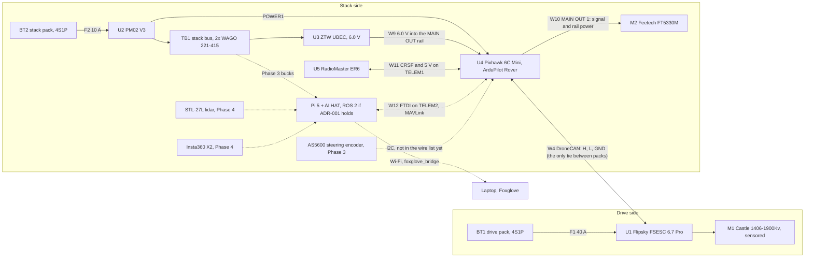

# Robocar v2: setup, configuration and decisions

_Every v2 decision made so far, its current status, the configuration values it
implies, and what is still open. Written 2026-10-14 from the project's design
chats, the Robocar v2 BOM, ADR-001 and the Phase 2 harness doc._

v2 is a personal build that continues the MAE 148 car (tagged
[`demo-v1`](../../../tree/demo-v1)) as a GNC and autonomy platform. Its job is
maze solving on road surfaces at up to about 5 m/s. The plan is a Tamiya
XV-02RS Pro chassis, a VESC with a sensored FOC motor, two 4S Li-ion packs, a
Pixhawk 6C Mini running ArduPilot Rover as the low-level controller, and a
Raspberry Pi 5 with an AI HAT for estimation, control and perception,
running ROS 2 if ADR-001's checkpoints hold. As of 2026-10-14 the Phase 2 harness is drawn but not built, and
neither ADR-001 checkpoint has run.

> **Links.** [`decisions/`](decisions/) (PR #6), [`v2-harness.md`](v2-harness.md)
> (PR #7) and [`field-network.md`](field-network.md) (PR #4) were not on `main`
> when this was written. Their links resolve once those PRs merge.

## Where each kind of decision lives

| What | Canonical source | Notes |
|---|---|---|
| Architecture decisions that might be reversed | [`docs/decisions/`](decisions/) | One ADR per decision. Superseded by a new ADR, never edited to say something else. |
| Wiring, connectors, ArduPilot/VESC settings tied to wiring, measured values | [`docs/v2-harness.md`](v2-harness.md) | If this file and the harness disagree, the harness wins. Fix this file. |
| Field network | [`docs/field-network.md`](field-network.md) | Router, addresses, rescue cable. |
| Parts, prices, acquisition status | [Robocar v2 BOM](https://claude.ai/code/artifact/95a5a032-dd2b-4524-b6dd-e8a1acaa87c4) (Claude Docs, private, outside the repo) | Don't copy the BOM into the repo. Name the change and Will updates it. |
| Everything else in this file | This file | Update the row and its date when a decision changes. |

Status words used below:

- **Decided**: Will chose it.
- **Conditional**: decided, with a written reversal test (ADR-001).
- **In place**: built or configured.
- **Planned**: part of the phase plan, not built yet.
- **Recommended**: proposed in a design chat and not yet explicitly confirmed. Confirm before building on it.
- **Open**: not decided. Listed again under [Open items](#open-items).

## The system at a glance



Solid lines are Phase 2, the radio-controlled car. Dashed lines arrive in
Phase 3 or later.

## Decision register

### Purpose and scope

| Decision | Status | Since | Why, and details |
|---|---|---|---|
| v2 is a personal GNC and autonomy platform, not tied to a class or team | Decided | 2026-10 | Will designs as if he owns all equipment and charging; lab access isn't a factor. |
| Task: maze solving, almost entirely on road surfaces | Decided | 2026-09 | Hardpack or gravel would be a stretch. |
| Target speed about 5 m/s | Decided | 2026-09 | Higher is acceptable, racing speeds aren't wanted. Low-speed control quality matters more; v1 struggled below its motor's usable minimum speed. |
| Drivetrain and suspension are off the shelf | Decided | 2026-09-11 | Swapping motor, ESC and electronics is fine; designing drivetrains or suspension geometry isn't. |
| Fabrication limited to 3D printing and laser cutting | Decided | 2026-09 | No other hand fabrication. Kits are fine. |
| Wiring harness first; custom carrier PCB deferred to v2.1 | Decided | 2026-09 | Prove the integration before committing copper. The [`hardware/carrier-board`](../../../tree/hardware/carrier-board/hardware/carrier-board) branch predates the Pixhawk and is reference material for v2.1 only. |
| Working name `lorelei` (hostname and SSID); "Caerdroia" suggested for the test maze | Open | 2026-09-18 | Shortlist was Lorelei and Caerdroia. The field network already uses `lorelei`. |

### Chassis and drivetrain

| Decision | Status | Since | Why, and details |
|---|---|---|---|
| Tamiya XV-02RS Pro, on-road variant | Decided | 2026-09 | Small footprint, tight turning radius, adjustable suspension to keep the lidar plane steady, and cheaper than the XV-02 Pro. Kit spec: 368 mm long, 180 mm wide, 257 mm wheelbase. |
| 39T ring gears in both diffs | Recommended | 2026-09-17 | Matched front and rear keep odometry and the vehicle model simple. The optional 40T gear and pinion stay bagged. |
| Castle Creations 1406-1900Kv sensored 4-pole motor | Decided, in hand | 2026-09-26 | Rated 3S–4S, crawler-tuned for smooth low RPM. Halls give low-speed FOC and odometry. |
| Flipsky FSESC 6.7 Pro (VESC 6) | Decided, in hand | 2026-09-26 | 8–60 V input covers a sagging 4S Li-ion pack. Built-in anti-spark switch, three-shunt VESC 6.7 hardware, stock VESC Tool support. |
| 17T pinion for a 10.71:1 final drive | Decided, in hand | 2026-09-26 | Final drive works out to about 182 ÷ pinion teeth. Chats quoted the kit's stock ratio as 9.58:1 and as 7.00:1 with a 26T pinion, so check the manual for how much this gears down. Lower gearing helps low-speed control and odometry resolution. Cap top speed in software with the VESC ERPM limit. |
| Odometry from the motor's hall sensors through the VESC, no wheel encoders | Decided | 2026-09-26 | The VESC itself counts about 1.6 mm per tach step at 10.71:1 (6 steps per electrical revolution, 4 poles). That figure assumed an MCU reading the VESC directly. Through the Pixhawk, the Pi only gets ESC RPM telemetry, so the resolution and rate it actually sees are open. Either way it averages the wheels through the diffs and can't see slip. |
| Keep the kit's rubber tires; printed TPU tires only as an optional low-grip test set; no larger diameter | Recommended | 2026-09-28 | Hard TPU cuts grip and adds vibration. Bigger tires would undo the gear reduction. |
| Steering: owned Feetech FT5330M servo on a 25T horn and servo saver | Decided, in hand | 2026-09 | Rated 6–7.4 V; run at 6.0 V. |
| Springs and shock oil chosen after weighing the loaded car | Planned (Phase 5) | 2026-10-01 | |

### Power

| Decision | Status | Since | Why, and details |
|---|---|---|---|
| Split power: a drive pack (VESC and motor only) and a stack pack (everything else) | Decided | 2026-09-11, kept 2026-10-07 | Keeps motor transients off the electronics, and steering stays powered if drive power is cut. A single 4S pack was suggested on 2026-09-26; the Oct 7 harness kept the split. |
| Two identical 4S1P Li-ion packs | Decided, ordered | 2026-09-26 | 3S kept ruling out VESC hardware with higher input floors. Identical packs allow swapping and one charge profile. The BOM prefers the Zero Point Orryx 4S1P (Molicel P45B); Flywoo Explorer P30B and 45D packs were also evaluated. Record the model and connector on arrival. |
| 4S Li-ion voltages: 16.8 V full, 14.4 V nominal, about 12.0 V empty (3.0 V/cell) | — | | These are Li-ion, not LiPo. Never leave a LiPo cutoff default or charge on a LiPo profile. |
| Li-ion balance charger with a 4.20 V/cell profile | Decided, in hand | 2026-09 | |
| One ground tie between the two sides: the GND in the CAN cable W4 | Decided | 2026-10-07 | A second tie makes a ground loop that carries motor current. So: nothing powered from the VESC's 5 V, the servo and ER6 return to the stack pack, and the VESC's USB never goes into the Pi on the car. |
| Fuses right after each pack: F1 40 A (drive), F2 10 A (stack), DaierTek 12 AWG blade holders | Decided | 2026-10-07 | VESC battery current max stays at 30 A or less so F1 only opens on a fault. |
| PM02 V3 powers the Pixhawk and measures the whole stack | Decided, ordered | 2026-10-05 | Every stack load taps TB1 after the PM02. Drive-pack voltage comes from VESC telemetry. This replaced the earlier INA226 plan. |
| Stack bus TB1: two WAGO 221-415 lever connectors, one per rail | Decided | 2026-10-07 | Five ports per rail: PM02 feed, UBEC and three Phase 3 bucks. Existing screw terminals were too big. |
| Servo rail: ZTW UBEC 8A G2 on 6.0 V, feeding the Pixhawk's MAIN OUT rail | Decided, in hand | 2026-10-07 | The Pixhawk doesn't regulate its servo rail, and the 8.4 V jumper would overdrive the servo. Meter 6.0 V before plugging the servo in. |
| Phase 3: three buck converters off TB1 for the Pi and sensor rails | Planned | 2026-10-07 | The lidar gets its own rail because its motor is a pulsing load. Specs are open. |
| Pi 5 feed: 5.1 V, at least 5 A, with the USB current limit raised | Recommended | 2026-09-26 | Without a USB-PD supply the Pi caps total USB current at 600 mA. One chat suggested `PSU_MAX_CURRENT=5000` in the bootloader EEPROM (applies before boot), another `usb_max_current_enable=1` in `config.txt`; pick one. The feed path is open, since the AI HAT covers the GPIO header. |
| Stack-pack undervoltage handling | Open | 2026-09-26 | The VESC cutoff only protects the drive pack. A staged plan proposed a Pi software shutdown near 12.8 V and a hardware backstop near 12.0 V; the PM02 reading in ArduPilot's battery monitor is the natural trigger. Nothing is assigned yet. |
| Bulk capacitor across the VESC input if W1 runs past about 15 cm | Planned | 2026-10-07 | From the harness checks. |

### Low-level control and RC

| Decision | Status | Since | Why, and details |
|---|---|---|---|
| Holybro Pixhawk 6C Mini (Model A) + PM02 V3, running ArduPilot Rover | Decided, ordered | 2026-10-05 | A proven ecosystem owns RC input, failsafe, actuators and logging, so effort goes into sysid, MPC and autonomy. The H743 chip has room for Lua scripting. ArduPilot Rover over PX4 because PX4's Ackermann rover module is still experimental. |
| RadioMaster Pocket (ELRS) with a RadioMaster ER6 receiver | Decided, in hand | 2026-10-04 | The ER6's CRSF lead is re-pinned into a GH-6 for TELEM1 (pin 2 TX to ER6 RX, pin 3 RX from ER6 TX). |
| Steering on MAIN OUT 1; throttle to the VESC over DroneCAN | Decided | 2026-10-07 | ArduRover's default steering output. |
| A transmitter switch gates every Pi command | Decided | 2026-10-07 | ADR-001 Checkpoint B criterion 2. |
| A dead CAN link stops the car (VESC app timeout about 0.5 s plus brake current) | Decided | 2026-10-07 | Measured in harness first power-up step 5 by unplugging W4. |
| Losing the Pi's command node stops the car on its own | Decided, mechanism open | 2026-10-07 | ADR-001 Checkpoint B criterion 3. The VESC timeout doesn't cover this: the Pixhawk keeps sending DroneCAN commands when the Pi goes quiet. The stop has to come from ArduPilot, through a Guided-mode command timeout, a companion heartbeat failsafe, or a timeout inside the Lua relay. The harness's step 5 note treats the two cases as one. |
| Pi to Pixhawk: DSD TECH SH-U09C5 (genuine FTDI FT232RNL) into TELEM2 | Decided, ordered | 2026-10-05 | Set to 3.3 V. FTDI TX to pin 3, RX to pin 2, GND to pin 6; VCC, CTS and RTS left off. Keeps the locking connector at the Pixhawk end. |
| Control interface: start in Guided mode with speed and turn-rate targets (Level B), then drop to direct steering and throttle through a Lua relay (Level A) for sysid and MPC | Recommended | 2026-10-05 | Level B gets the car moving quickly. Sysid at Level B identifies the closed-loop plant, not the raw car. |
| Indoors, Guided mode needs a position estimate, so the Pi feeds external odometry to ArduPilot | Recommended | 2026-10-05 | 2D-lidar users hit this. Test it early. |
| AS5600 read by a Lua script on the Pixhawk over I2C | Recommended | 2026-10-05 | Lua reads I2C one byte at a time, which is fine for a two-register angle. Lua needs the microSD card (ordered). |

### Compute and operating system

| Decision | Status | Since | Why, and details |
|---|---|---|---|
| Raspberry Pi 5 with AI HAT (owned) | Decided, in hand | 2026-09 | Runs estimation, MPC, perception and planning. Detection runs on the HAT's Hailo accelerator. |
| No Pi GPIO; USB wherever possible | Decided | 2026-10-05 | The HAT covers the header, and header jumpers don't survive a car that crashes. |
| Ubuntu 24.04 with ROS 2 Jazzy and HailoRT, installed by a script that rebuilds a fresh SD card | Conditional | 2026-10-07 | ADR-001 Checkpoint A. The Pi currently runs Raspberry Pi OS Lite (trixie) per the field-network doc. Fallback: Raspberry Pi OS with Jazzy in Docker and the Hailo device passed through. |
| Stable serial device names via udev or `/dev/serial/by-id/`; FTDI `latency_timer` set to 1 | Recommended | 2026-10-05 | `ttyUSB0` and `ttyUSB1` can swap between boots. The default 16 ms FTDI buffer adds jitter. |
| Short right-angle USB cables, tied down next to each connector | Recommended | 2026-10-05 | USB-A isn't built for crashes. |

### Sensors

| Decision | Status | Since | Why, and details |
|---|---|---|---|
| IMU: the Pixhawk's isolated internal IMUs feed the estimator | Decided | 2026-10-05 | The two owned SparkFun LSM6DSO boards are spares or a second IMU. The ICM-42688-P purchase was dropped. |
| No magnetometer in the estimator | Decided | 2026-09-26 | Motor fields corrupt it. |
| Steering angle: owned AS5600 on the steering bellcrank, not the kingpin | Decided | 2026-09-26 | 4096 counts per turn (about 0.088°). Needs a printed bracket and magnet carrier that hold the magnet on axis within about 0.25 mm. Open: does the bellcrank post leave room? |
| AS5600 handling rules | Recommended | 2026-10-01 | Tie DIR to GND. Never burn ZPOS, MPOS or MANG (three burns at most for ZPOS/MPOS, one for MANG); do offset and scaling in software. Fix the filter setting and turn hysteresis off before servo ID. Set the air gap with the magnet-status bits and AGC. Confirm the magnet is 6 mm diametric. Fixed I2C address 0x36, so one sensor per bus. Written for the NUCLEO; the supply notes change on the Pixhawk (see Open items). |
| Lidar: LDROBOT STL-27L 2D lidar (Phase 4) | Decided | 2026-09-26 | The class's 2D lidar worked; 3D isn't worth the price. The STL-27L adds resolution (0.167°) and outdoor light rejection. |
| Camera: owned Insta360 X2 (Phase 4), used for 360° semantics for the planner | Decided | 2026-09 | Kept out of the control loop under the 2026-10-01 sysid and MPC plan. |
| Mount the X2 with one lens facing forward, on the lidar's vertical axis | Recommended | 2026-09-16 | Left/right lenses put the stitch seam dead ahead, where its error can't be calibrated out. Co-locating camera and lidar in x–y reduces extrinsics to one yaw offset. A 45° yaw is the compromise if side classification matters. |
| Camera and lidar co-located on one vertical axis, aiming for close to full 360° in both; some occlusion accepted, then measured | Decided | 2026-10-14 | Will's goal for the sensor mount. Settles the co-location half of the row above; its lens orientation stays Recommended. Whatever holds the upper sensor blanks a wedge of the lower one, so measure the occluded arcs once the mount exists. |
| Read the X2 in USB webcam mode: a UVC camera carrying the full 360°, stitched on the camera, as two stacked 180° strips at up to 1920×1080, 30 fps. The CameraSDK only if that falls short | Recommended | 2026-10-14 | Measured in [`v2-camera.md`](v2-camera.md). No vendor SDK and no stitching on the Pi, and about 10.7 px/° horizontally against v1's 6. The cost is a band around the horizon rather than the full sphere; its extent isn't measured yet. Raw dual fisheye needs the CameraSDK in Android mode. |
| Biggest fusion error sources, in order: lidar plane height, then time sync and motion skew (deskew scans with odometry) | Recommended | 2026-09-16 | |

### Software runtime

| Decision | Status | Since | Why, and details |
|---|---|---|---|
| ROS 2 for the v2 runtime | Conditional | 2026-10-07 | [ADR-001](decisions/ADR-001-ros2-runtime.md). Confirmed or reversed at Checkpoints A and B. If A fails, spend one more weekend on Raspberry Pi OS with Jazzy in Docker; if that fails too, revert to ROS-free before writing any car code. |
| No more than 3 weekends of ROS-specific effort from the start through Checkpoint B | Conditional | 2026-10-07 | Hardware, firmware and Pixhawk setup that a ROS-free build would also need don't count. |
| `src/` algorithm packages stay ROS-free and unchanged | Decided | 2026-10-07 | ADR-001's design rule. `rclpy` appears only in thin `*_node.py` wrappers, and driver logic follows the same rule. This keeps the exit cheap. |
| Before Checkpoint B, write only drivers, bridges, launch files and config | Decided | 2026-10-07 | Don't wrap the `src/` algorithms in nodes until B passes. |
| Six coarse nodes: Pixhawk bridge, lidar, camera + detector, perception, estimator, guidance/control on a fixed-rate tick | Conditional | 2026-10-07 | ADR-001's initial configuration, revisited at Checkpoint A. Perception publishes `cone_msgs/LabeledConeArray` (already defined in [`src/cone_msgs`](../src/cone_msgs/msg)). |
| MAVROS first for the Pixhawk link; a pymavlink node is the fallback | Conditional | 2026-10-07 | Initial configuration. ArduPilot's DDS interface is the other option. |
| Images never pass between Python nodes | Conditional | 2026-10-07 | Initial configuration. The camera node publishes detections plus a throttled, compressed preview. |
| Guidance and control run on a fixed-rate tick; target 50 Hz | Conditional | 2026-10-07 | Replaces v1's single 10 Hz loop. Checkpoint B criterion 6 measures it. ADR-001's checkpoint numbers were proposed by Claude, to adjust as needed. |
| robot_localization and Nav2 are reference baselines only, never in the loop | Conditional | 2026-10-07 | Initial configuration. |
| One command, or systemd at boot, starts the whole stack | Conditional | 2026-10-07 | Checkpoint B criterion 4. |
| Cone detector compiled for the Hailo | Open | 2026-10-07 | Needed with or without ROS. Checkpoint A only uses a stock model-zoo YOLO as a stand-in. |
| Train a new cone detector on X2 images; v1's `weights-v3` isn't carried over | Decided | 2026-10-14 | Will's decision. v1's detector learnt rectilinear 416×234 OAK-D frames. Which X2 image it trains on is open (see Open items), and has to be fixed before capture, since training images must match what the car sees at run time. |

### Data, logging and visualization

| Decision | Status | Since | Why, and details |
|---|---|---|---|
| Record with rosbag2 to MCAP; read bags in Foxglove and in MATLAB `ros2bagreader` | Decided | 2026-10-07 | System ID happens in MATLAB straight from car bags. `ros2bagreader` reads MCAP from R2024a on. Checkpoint B criterion 5 checks both. |
| The tick node publishes its per-tick decision record; a bag-to-JSONL exporter keeps `junction_report.py`, `map_from_log.py` and `sim/` working | Decided | 2026-10-07 | |
| Foxglove is the dashboard; the laptop reaches the car through foxglove_bridge only | Decided | 2026-10-07 | DDS traffic never crosses Wi-Fi (ADR-001). The free tier was the suggested plan. QGroundControl or Mission Planner is for parameter setup only. |
| Keep a custom status panel possible | Decided | 2026-10-14 | Will's requirement, stated in the dashboard chat. |
| Dashboard layout: a Drive tab (3D view with lidar, fused detections, pose and path; Log; Diagnostics) and a Tracking tab (commanded vs measured speed and steering; video with detections) | Decided | 2026-10-14 | Will's target layout. Keep the health summary outside the tabs. Commit the layout file next to the topic list. |
| Topic contract, status message and data rules | Recommended | 2026-10-14 | See [Interface proposal](#interface-proposal-2026-10-14). Settle it before writing the Pixhawk bridge, since that node sets units and timestamps. |

### Estimation, system ID and control

| Decision | Status | Since | Why, and details |
|---|---|---|---|
| Own EKF on the Pi: wheel odometry plus IMU, with lidar as a slower correction | Planned (Phase 3, lidar in Phase 4) | 2026-10-01 | A prerequisite for MPC. It publishes odom and TF. |
| Wheel odometry computed on the Pi from ESC RPM telemetry | Recommended | 2026-10-05 | It's unconfirmed whether ArduPilot's EKF can use ESC telemetry as wheel odometry. The VESC → Pixhawk → Pi telemetry rate is unknown; measure it. |
| System ID before MPC: steering map, servo dynamics, actuator latency, understeer | Planned | 2026-10-01 | Likely a bigger win than MPC alone. |
| Report MPC as an ablation: pure pursuit vs calibrated pure pursuit vs MPC | Planned | 2026-10-01 | An honest, quantitative result, and a resume artifact. |
| Bring-up order: actuation, then proprioceptive estimation, then lidar fusion | Planned | 2026-10-01 | |
| Validation rig (Phase 3B): overhead phone video at 60 fps with an AprilTag (tag36h11, about 100 mm) on the car, ChArUco intrinsics, a sync LED, two kitchen scales for mass and CG, a bifilar pendulum for yaw inertia | Planned | 2026-10-01 | Ground truth is for measuring results, not for bringing MPC up. The sync LED was to hang off an MCU GPIO; with the NUCLEO gone and Pi GPIO ruled out, what drives it is open. |
| Taped floor course: figure-eight plus a square with 90° corners | Planned | 2026-10-01 | For dead-reckoning MPC bring-up. |
| Effective steering angle δ = atan(L·r/v) from yaw rate, plotted against the AS5600 | Recommended | 2026-10-14 | The gap between them is steering flex and understeer. Only meaningful above a minimum speed. |

### Field network

| Decision | Status | Since | Why, and details |
|---|---|---|---|
| Own travel router: GL.iNet GL-MT3000 (Beryl AX), SSID `lorelei`, router `192.168.148.1`, car reserved at `192.168.148.221` | In place | 2026-09-26 | [`field-network.md`](field-network.md). v1's phone hotspot moved the car's address between sessions. |
| Rescue path: ethernet straight to the Pi (`eth0` static `10.0.148.2/24` plus link-local IPv6) | In place | 2026-09-26 | `ssh lorelei-eth`. |
| Field internet only by iPhone USB tether into the router, never the router's repeater mode | In place | 2026-09-26 | Repeater mode restarts both radios and drops the car. |
| The RC link is the manual override and kill, independent of Wi-Fi | Decided | 2026-09-21 | Now through the Pixhawk. |

### Mechanical and fabrication

| Decision | Status | Since | Why, and details |
|---|---|---|---|
| Everything (compute, sensors, electronics, both packs) on one central stack, attached to the chassis at a few mounting points | Decided | 2026-09 | Only the motor, servo and stack mounts touch the car. Enclose the stack later for looks and protection. |
| Stack panels laser-cut from cast acrylic at the makerspace; Delrin instead if it's free there | Decided | 2026-10-05 | Replaced a service-cut tapped 6061 aluminum plate once laser access returned. No wood. |
| M3 hole grid at 10 mm pitch; through-holes with nyloc nuts, no tapped holes | Decided | 2026-10-05 | Adaptability lives in per-component printed sleds, not in the plate. Open: whether to go back to interleaved top/bottom grids now that through-holes couple the two faces again. |
| Acrylic rules: cast, 5–6 mm; washers and pan heads, no countersinks; gentle torque; no threadlocker (it crazes acrylic); holes at least two diameters from edges | Recommended | 2026-10-05, 2026-10-14 | Acrylic cracks at bolt holes under impact or overtightening. |
| One engineering filament at home: PETG-CF on a permanently fitted 0.4 mm hardened-steel A1 Mini hotend, one saved preset | Decided | 2026-09-18 | Switching is a filament swap plus a dropdown. Detach the preset from its system parent and export a backup. Feed CF from the external spool, not the AMS Lite. Dry at 65 °C in the SUNLU S2. |
| PETG-CF brand | Open | 2026-09-18 | First pick Polymaker Fiberon PETG-rCF08; its low impact strength and elongation prompted a rethink. Bambu PETG-CF is recommended, ELEGOO PETG-CF the fallback. |
| TPU 95A HF for bumpers and impact parts | Planned | 2026-09-18 | Siraya Tech TPU-GF was also being profiled (2026-10-11). |
| Makerspace printers for parts that repeatedly fail; no resin printer | Recommended | 2026-10-14 | Resin is brittle. It's only for cosmetic trim, or the encoder holder and plug retainer if a PETG-CF tolerance print proves too sloppy. |
| Printed-part rules: fillet inside corners, load paths along layers, heat-set inserts where joints get reopened, deliberate weak links (nylon screws on the lidar mount) | Recommended | 2026-09-18 | |
| No CF-filled material around the ER6 antenna tips | Recommended | 2026-10-04 | Carbon fill can be conductive. Only the bare tip (about 3 cm) matters for RF. |
| ER6 antennas in a V about 45° off vertical, tips spread apart and clear of packs, VESC, lidar scan plane, camera view, the Pi and USB 3 cables | Recommended | 2026-10-07 | Verify with the Pocket's ELRS telemetry (1RSS, 2RSS, ANT) while walking around the car. |
| CAD: no public XV-02 model exists; model one interface plate referenced to 4–6 caliper-verified chassis points, and keep-outs instead of full parts | Recommended | 2026-09-18 | A phone photogrammetry scan serves as a reference mesh. Fit a plane to the floor and set it as z = 0 before cutting it away; it fixes ride height and the vehicle frame. |

### Body

| Decision | Status | Since | Why, and details |
|---|---|---|---|
| Open-wheel chassis with a body that covers the stack; the plate now extends over the wheels | Decided | 2026-10-01 | |
| Retro-futurist streamliner: Streamline Moderne shell from early open-wheel race cars, grown toward sci-fi forms with some Detroit concept-car eccentricity | Decided | 2026-10-01 | |
| Deliberate asymmetry, offset by volume (sensor mast, camera nacelle), never by mass | Decided / Recommended | 2026-10-01 | Asymmetry is Will's choice. Keeping mass symmetric avoids an asymmetric inertia tensor in the dynamics model. |
| Formers-and-skin construction, transverse segments, and CAD that keeps the master surface, sensor envelopes and derived panels separate | Recommended | 2026-10-01 | Print an undetailed mule shell first to check lidar clearance, camera occlusion, heat and connector access. Wheel wells must clear the tire's swept envelope at full lock, compression and droop together. |

### Process and sourcing

| Decision | Status | Since | Why, and details |
|---|---|---|---|
| GitHub PRs are the system of record; the Claude Project carries cross-session context | Decided | 2026-10 | Project copies of repo docs defer to the repo. |
| Robust connectors on every device: locking connectors or screw/lever terminals, no friction-fit jumpers | Decided | 2026-10-05 | MAIN OUT is the one friction-fit header; W9 and W10 get a printed retainer. |
| Buy from as few vendors as possible: Amazon, Holybro and local or makerspace stock | Decided | 2026-10-05 | Small vendors ship slowly. The makerspace supplies wire, JST-PH housings, 120 Ω resistors, XT60s, a crimper and the laser cutter. |
| GH connectors from a pre-crimped JST-GH kit (push-in terminals, no GH crimper); tug-test every terminal | Decided, ordered | 2026-10-05 | Check listings are genuine JST-GH, not Molex PicoBlade lookalikes. |

## Configuration

Values the decisions above imply. Rows marked _harness_ are copied from
[`v2-harness.md`](v2-harness.md), which wins if they ever differ.

### ArduPilot (Pixhawk 6C Mini, Rover)

| Parameter | Value | Status |
|---|---|---|
| `SERIAL1_PROTOCOL` | 23, RC input (CRSF on TELEM1) | Decided, _harness_ |
| `SERVO1_FUNCTION` | 26, ground steering | Decided, _harness_ |
| `CAN_P1_DRIVER` · `CAN_D1_PROTOCOL` | 1 · 1 (DroneCAN) | Decided, _harness_ |
| `SERVO3_FUNCTION` · `CAN_D1_UC_ESC_BM` | 70 throttle · 4 (output 3 → ESC index 2) | Decided, _harness_ |
| CAN bitrate | Must match the VESC; ArduPilot defaults to 1 Mbit/s | Decided, _harness_ |
| TELEM2 (`SERIAL2_*`) | MAVLink 2 for MAVROS; baud not chosen | Open |
| `SCR_ENABLE` | 1, for the AS5600 reader and a Level A relay | Recommended |
| RC channel map, arm switch, mode switch, RC failsafe action | Not set. ArduPilot Rover's defaults differ from the Oct 4 EdgeTX plan (CH1 steering, CH2 throttle, CH5 arm), so pick one and record it here | Open |
| ESC telemetry stream rate to the Pi | Request a fixed rate, then measure what arrives | Open |
| Stop on loss of Pi commands | Guided-mode command timeout, companion heartbeat failsafe, or a timeout in the Lua relay | Open |
| Battery monitor (PM02, stack pack) low and critical thresholds | Li-ion values; ties into the stack-pack undervoltage plan | Open |

### VESC (Flipsky FSESC 6.7 Pro, VESC Tool)

| Setting | Value | Status |
|---|---|---|
| CAN mode · CAN ID · ESC index | UAVCAN · 1 (avoid 0) · 2 | Decided, _harness_ |
| App timeout and brake current | About 0.5 s, so a dead CAN link stops the car | Decided, _harness_ |
| Battery current max | 30 A or less (below F1). Earlier chats suggested 20–25 A | Decided, _harness_ |
| Battery current min (regen) | A few amps only; it's charge current into the cells | Recommended |
| Motor poles | 4, set by hand; detection won't infer it | Required |
| Motor and hall detection | Run over USB with the wheels off the ground, then hand throttle to CAN | Decided, _harness_ |
| Gear ratio and wheel diameter | 10.71:1; measure the wheel diameter | Decided (ratio) |
| ERPM limit | Caps top speed in software; value open | Recommended |
| Battery low-voltage cutoff (start / end) | Use Li-ion values, never the LiPo default. Chats proposed 13.2 / 12.0 V, 13.6 / 13.2 V and 12.8 / 12.0 V; pick one | Open |
| Motor temperature sensor | Disable it if the Castle lead's temp pin reads nonsense | Conditional |

### Power and harness checks

| Item | Value | Status |
|---|---|---|
| UBEC jumper | 6.0 V; meter at MAIN OUT column 8 before the servo goes on | Decided, _harness_ |
| CAN termination | With both packs off, CAN H–L reads about 60 Ω; at about 120 Ω add one 120 Ω resistor | Decided, _harness_ |
| CAN wiring | H, L, GND only, H and L twisted, 5 V pin left open | Decided, _harness_ |
| Pi 5 supply | 5.1 V, at least 5 A; raise the USB current limit with `PSU_MAX_CURRENT=5000` (EEPROM) or `usb_max_current_enable=1` (`config.txt`) | Recommended, method open |

### Raspberry Pi and ROS 2

| Item | Value | Status |
|---|---|---|
| OS and ROS | Ubuntu 24.04, ROS 2 Jazzy, HailoRT; scripted install from a fresh SD card | Conditional (Checkpoint A) |
| Hostname, user, login | `lorelei`; user `pi`; SSH keys only | In place |
| Network profile | Per [`field-network.md`](field-network.md); must be recreated if the OS is reinstalled | In place |
| Pixhawk device | `/dev/serial/by-id/` path for the FTDI; `latency_timer` 1 | Recommended |
| Tick rate | 50 Hz fixed; log the jitter; CPU under about 70% with the detector running, no thermal throttling | Conditional (Checkpoint B criterion 6) |
| Checkpoint A detector | A stock Hailo model-zoo YOLO, 10 Hz or faster, inside a ROS node on live frames. A stand-in only; the cone detector is compiled separately | Conditional (Checkpoint A criterion 2) |
| Parameters | YAML, replacing v1's CLI flags | Conditional |

## Phase plan

Phases run in build order and each ends in something that works. The BOM
tracks the parts per phase.

| Phase | Delivers | Gate | State on 2026-10-14 |
|---|---|---|---|
| 1 Chassis | Rolling chassis with working steering | | Parts in hand |
| 2 Manual drive | The radio-controlled car: driven through the Pixhawk, VESC on CAN, both packs fused and mounted on the stack, onboard logs | Harness first power-up, steps 1–5 | Harness drawn (PR #7), not built. Ordered: Pixhawk set, packs, microSD, GH kit. Still to get: motor sensor adapter and bullets, fuse holders and 10 A fuses, XT60s, WAGO connectors, battery straps, PETG-CF. To make: acrylic panels and the printed mounts |
| Checkpoint A (alongside Phases 1–2) | Ubuntu, Jazzy and HailoRT on the bench Pi; detector in a ROS node; laptop sees it through foxglove_bridge | [ADR-001 A](decisions/ADR-001-ros2-runtime.md#checkpoint-a-platform-tripwire), one weekend | Pending |
| 3 Compute and sensing | Pi linked to the Pixhawk; IMU and odometry EKF; measured steering angle; MPC on a taped course | [ADR-001 B](decisions/ADR-001-ros2-runtime.md#checkpoint-b-the-inflection-point) | Not started. FTDI cable ordered; Pi, AS5600 and LSM6DSO boards in hand |
| 3B Validation | Ground truth for the model, the estimator and the MPC vs pure pursuit numbers; mass, CG and yaw inertia | | Not started |
| 4 Perception | Lidar fused into the EKF; corridor constraints; camera detections | ADR-001 watch item: if perception can't keep up with the lidar, consolidate it into one process or a C++ composable node | Not started |
| 5 Suspension | Spring rates set from the loaded weight | | Not started |

## Working rules

These hold for anyone changing the repo, including Claude Code.

1. **Algorithm code never imports `rclpy`.** Algorithm and driver logic live in
   plain Python modules. `rclpy` appears only in thin `*_node.py` wrappers. Tests
   run on a laptop with no ROS installed.
2. **Before Checkpoint B passes, write only drivers, bridges, launch files and
   config.** Don't wrap `src/` packages in nodes yet.
3. **The car publishes facts; the viewer draws them** (recommended 2026-10-14).
   No markers or annotated video produced on the Pi.
4. **Timestamp at measurement, SI units everywhere.** Raw servo microseconds and
   motor RPM exist only inside the Pixhawk bridge (recommended 2026-10-14).
5. **One ground tie.** Never add a second connection between the drive and stack
   sides. In particular, don't plug the VESC's USB into the Pi on the car to get
   faster telemetry.
6. **Locking connectors only.** No Pi GPIO, no new friction-fit joints.
7. **Never write the AS5600's one-time-programmable registers.**
8. **Li-ion numbers, not LiPo numbers,** for cutoffs and charging.
9. **Decisions are recorded, not edited away.** Reversing something in
   `docs/decisions/` takes a new ADR. Changing a row here means updating its
   status and date and moving the old choice to [Superseded](#superseded-choices).
   Measured values go in the harness bring-up log or the ADR checkpoint log.
10. **The BOM stays outside the repo.** When a change affects parts, say what
    should change in the BOM rather than recreating it here.

## Interface proposal (2026-10-14)

Recommended, not yet adopted. Will's requirements are the dashboard layout and
keeping a custom status panel possible; the topic table and message below are
the proposal that meets them. Confirm before writing the Pixhawk bridge.

| Topic | Type | Rate | Shown in |
|---|---|---|---|
| `/scan` | `sensor_msgs/LaserScan` | 10 Hz | 3D |
| `/perception/cones` | `cone_msgs/LabeledConeArray` | 10 Hz | 3D, via a Foxglove message converter |
| `/tf`, `/odom` | tf2, `nav_msgs/Odometry` | 50 Hz | 3D (car pose) |
| `/planning/centerline` | `nav_msgs/Path` | 10 Hz | 3D |
| `/control/predicted_path` | `nav_msgs/Path` | controller rate | 3D |
| `/control/cmd` | `ackermann_msgs/AckermannDriveStamped` | 50 Hz | Tracking |
| `/vehicle/state` | `ackermann_msgs/AckermannDriveStamped` | whatever telemetry allows | Tracking |
| `/camera/preview/compressed` | `sensor_msgs/CompressedImage` | about 5 Hz, downscaled, only frames that went through detection | Image |
| `/camera/detections` | `vision_msgs/Detection2DArray` | camera rate | Image (via the converter), perception |
| `/rosout` | `rcl_interfaces/Log` | | Log |
| `/diagnostics_agg` | `diagnostic_msgs/DiagnosticArray` | 1 Hz | Diagnostics |
| `/status` | `robocar_msgs/VehicleStatus` | 5 Hz, latched | Pinned status area |

The Pixhawk bridge also publishes the servo and motor outputs the Pixhawk
actually sent, as a third series on the Tracking plots. That separates "the
controller asked for the wrong thing" from "the car didn't follow", and it's
the only true command when the transmitter or a failsafe is driving.

The go/no-go decision is computed on the car, so it can block autonomous
commands, can be tested with pytest, and is in the recording:

```
# robocar_msgs/VehicleStatus: the only topic the status panel reads
std_msgs/Header header
bool ready                 # go/no-go, decided on the car
string[] blocking          # reasons, in plain words
string mode                # ArduPilot mode
bool armed
bool rc_link
bool failsafe
float32 drive_pack_v       # VESC input voltage, via the Pixhawk's ESC telemetry
float32 stack_pack_v       # PM02
TopicRate[] rates          # name, measured_hz, expected_hz
string estimator           # OK / DEGRADED / LOST
float32 cpu_temp_c
float32 disk_free_gb
bool recording
```

## Superseded choices

Earlier decisions that were replaced. Don't bring these back without a new
decision.

| Was | Now | Changed | Why |
|---|---|---|---|
| Traxxas 1/16 Slash 4x4, then Tamiya XV-02 Pro | XV-02RS Pro | 2026-09 | Payload fraction, motor options, cost |
| PCB-first electrical design | Harness first, PCB in v2.1 | 2026-09 | Prove integration first |
| 2× SwiftCore 3S1P Molicel P30B | 2× 4S1P Li-ion | 2026-09-26 | 3S kept ruling out VESCs |
| Holybro Mini FOC, then Flipsky Mini V6 MK5 | FSESC 6.7 Pro | 2026-09-26 | No CAN and scarce; a 14 V input floor above a sagging 4S pack |
| Single 4S pack (suggested after the move to 4S) | Split packs kept | 2026-10-07 | Phase 2 harness |
| NUCLEO-G474RE MCU as CAN master and watchdog, with a CAN transceiver, voltage divider, INA226 and a 1PPS sync line to the Pi | Pixhawk 6C Mini + PM02 | 2026-10-05 | A proven low-level stack; effort goes to GNC |
| ER6 PWM straight to servo and VESC; UBEC into the ER6's BATT port; CRSF into a Pi UART | CRSF into Pixhawk TELEM1; UBEC onto the Pixhawk servo rail | 2026-10-05 | Pixhawk architecture; no Pi GPIO |
| Buy an ICM-42688-P IMU (then use the owned LSM6DSO) | Pixhawk internal IMUs | 2026-10-05 | Isolated IMUs already on the controller |
| v1's 15 mm M4 grid; interleaved M3 A/B grids; tapped 6061 aluminum from SendCutSend | Laser-cut acrylic, M3 10 mm through-holes, nyloc nuts | 2026-10-05 | Laser cutter access, free stock |
| Generic Hobbywing BEC | ZTW UBEC 8A G2 | 2026-10-07 | Already ordered |
| Screw terminal blocks for TB1 | 2× WAGO 221-415 | 2026-10-07 | Size |
| Single 10 Hz host loop, Foxglove SDK, ROS-free (v1) | ROS 2, conditional | 2026-10-07 | ADR-001 |

## Open items

Ordered roughly by when they block work.

- [ ] **Pi OS conflict.** [`field-network.md`](field-network.md) describes Pi OS
      Lite (trixie); ADR-001 moves the Pi to Ubuntu 24.04. Reinstalling wipes the
      NetworkManager profiles and the `eth0` rescue setup, so the Checkpoint A
      install script has to recreate them, and the field-network doc needs updating.
- [ ] **When Checkpoint B runs.** ADR-001 places it at the end of Phase 3, but
      Phase 3 also delivers the EKF and MPC, which would be ROS-wrapped code.
      The reading that fits both is: B runs once the Pi commands the car through
      the Pixhawk, before EKF and MPC nodes are written. Confirm and note it in
      the checkpoint log.
- [ ] **Before crimping W3 and W4.** Read the FSESC 6.7 Pro's CAN and HALL pin
      order off the board silkscreen, and meter the Castle sensor lead's 5 V,
      GND and temp wires before cutting it (from the harness's arrival checks).
- [ ] **VESC low-voltage cutoff.** Pick Li-ion values (see Configuration).
- [ ] **Packs.** Record the model, connector (the harness assumes XT60) and
      dimensions on arrival; check the battery bay and stack footprint.
- [ ] **RC mapping.** Channel map, arm switch, mode switch and RC failsafe
      action in ArduPilot; matching ER6 failsafe behavior.
- [ ] **Stop on command-node loss.** Choose the ArduPilot mechanism that stops
      the car when the Pi stops commanding (Checkpoint B criterion 3), and
      separate it from the CAN-loss stop in the harness's step 5 wording.
- [ ] **Stack-pack undervoltage.** Battery monitor thresholds on the PM02, the
      Pi's shutdown trigger, and what happens at each.
- [ ] **ESC telemetry rate.** Measure the VESC → Pixhawk → Pi RPM rate and delay;
      proposed as part of Checkpoint B's timing test. It limits both the
      Tracking plot and speed-response sysid.
- [ ] **AS5600 on the Pixhawk.** Add it to the wire list. The Pixhawk's I2C port
      supplies 5 V, but many modules bridge VDD5V to VDD3V3 for 3.3 V use, and
      that pin tops out at 3.6 V. Either unbridge the module for 5 V operation
      or give it 3.3 V, and keep its pull-ups from holding SDA and SCL at 5 V.
      Tie DIR to GND. Check the bracket fits the bellcrank post.
- [ ] **Guided mode indoors.** Feed external odometry to ArduPilot; test before
      relying on Level B.
- [ ] **Cone detector on the Hailo.** Compile it; needed with or without ROS.
- [ ] **Sync LED.** Decide what drives it now that the NUCLEO is gone.
- [ ] **Pixhawk-to-Pi time alignment.** The MCU's 1PPS sync line went away with
      the NUCLEO. Decide how Pixhawk sample times map to Pi time.
- [ ] **Phase 3 power.** Buck specs (Pi, lidar, sensors), the Pi feed path, and
      local bulk capacitance.
- [ ] **Insta360 X2 on the Pi.** Partly answered 2026-10-14 in
      [`v2-camera.md`](v2-camera.md): webcam mode works and sends the full 360°
      stitched on the camera; raw dual fisheye is available only through the
      CameraSDK in Android mode. Still open: the band's vertical extent and
      whether it holds the horizon, where the stitch seams fall in the frame,
      the wire format on the Pi (MJPEG or H.264), USB power draw and charging,
      heat over a session, and latency.
- [ ] **Detector training input.** Webcam strips, raw fisheye, or perspective
      crops cut from either. Fix it before capturing training data.
- [ ] **STL-27L connection.** Confirm the kit's USB adapter and which rail
      powers its motor.
- [ ] **Stack grid.** Whether to bring back interleaved top/bottom grids now
      that through-holes couple the two faces; makerspace acrylic thickness;
      whether Delrin is free.
- [ ] **PETG-CF brand.**
- [ ] **Interface proposal.** Adopt or amend the topic table and `/status`
      message before writing the Pixhawk bridge.
- [ ] **README pointer.** PR #4's README note says v2 has "a new carrier board"
      and "a 4S Li-ion pack". v2 is harness-first with the board in v2.1, and
      it has two packs.
- [ ] **Maze-solving strategy.** Trémaux's algorithm came up as the general
      form of v1's dead-end rule (0/1/2 passage counts instead of 0/1). It needs
      persistent place recognition. Not decided.
- [ ] **Car name.** Lorelei or Caerdroia.

## Where these decisions were made

Design chats in the Robocar v2 Claude Project, newest first, dated in Pacific
time by when each chat last changed. They aren't in the repo; this file is
the record of them.

| Date | Chat | Covered |
|---|---|---|
| 2026-10-14 | Claude Code session in this repo (not a Project chat) | X2 identified and measured in webcam mode, co-location goal, new detector |
| 2026-10-14 | Robocar v2 dashboard and ROS2 migration | Foxglove, ROS 2 decision (ADR-001), interface proposal |
| 2026-10-14 | FDM vs resin printer performance | Resin vs FDM, acrylic handling |
| 2026-10-07 | Phase 2 wiring diagram and BOM | Harness, UBEC, WAGO TB1, fuses |
| 2026-10-07 | V-shaped antenna mounts | Antenna placement |
| 2026-10-05 | AI hat GPIO obstruction issue | No GPIO, Pixhawk 6C Mini, acrylic, FTDI, GH kit, vendors |
| 2026-10-04 | RC car components checklist; RadioMaster ER6 ELRS setup | Receiver, BEC, connectors, failsafe |
| 2026-10-01 | Robocar MPC and hardware setup | Sysid and MPC plan, validation rig, BOM phasing |
| 2026-10-01 | Retro-futurist vehicle body design | Body |
| 2026-09-28 | Robocar wheel materials and sizing | Tires |
| 2026-09-28 | Phone 3D scanning robocar chassis | Photogrammetry reference |
| 2026-09-26 | Robocar v2 parts specification; 4S battery and motor compatibility; ESK8 ESC controller comparison | Chassis, 4S, ESC, motor, gearing, sensors, power |
| 2026-09-22 | Robocar modular mounting plate | Plate and grid |
| 2026-09-21 | Robocar v2 field connectivity | Field network |
| 2026-09-18 | Maze-solving robot name; XV02 3D model sourcing | Name, CAD strategy |
| 2026-09-17/18 | 3D printing materials for robocar v2; Oil in the XV02 gearbox differential | Printing setup, diffs |
| 2026-09-16 | Sensor fusion with colocated camera and lidar | Camera orientation, co-location |
| 2026-09-11 | Sourcing Li-ion batteries for RC car upgrade | Split power |
| 2026-09-11 | Choosing the right scale for robocar v2 | Off-the-shelf chassis rule |
